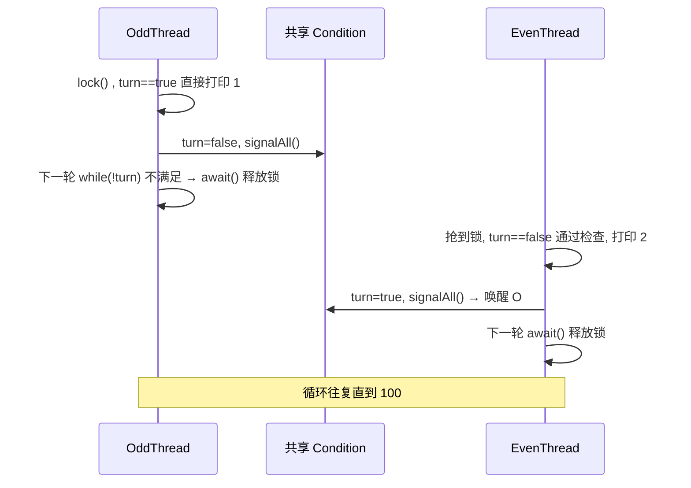

# 题解：两个线程交替打印奇偶数

## 📌 题目

启动两个线程，一个线程打印奇数（1, 3, 5, ...），另一个线程打印偶数（2, 4, 6, ...），要求**严格按 1, 2, 3, 4, ... 的顺序交替输出**，直到打印完 1~N（本题 N=100）。

```text
预期输出：
OddThread: 1
EvenThread: 2
OddThread: 3
EvenThread: 4
...
```

考察点：**线程间协作（等待/通知机制）**、`ReentrantLock` 与 `Condition` 的正确用法、共享状态的可见性与封装。

---

## 🧭 思路演进（四个经典踩坑点）

### 坑 1：对 Lock 对象直接调用 `wait()` → `IllegalMonitorStateException`

```java
lock.wait();   // ❌ lock 是 ReentrantLock，不是 synchronized 监视器
```

`wait()/notify()` 是 `Object` 的方法，**必须在 `synchronized (obj)` 块内调用**（即持有 obj 的对象监视器）。`ReentrantLock` 是 API 层面的锁，`lock()` 不会获取对象监视器，直接调用就抛 `current thread is not owner`。

> **规则：synchronized 配 wait/notify，ReentrantLock 配 Condition 的 await/signal，两套体系不能混搭。**

### 坑 2：`await()` 不在 `lock()` 之后调用 → 同样抛异常

`Condition` 的 `await()/signal()` 也必须由**持有该 Condition 所属 Lock 的线程**调用。`await()` 的语义是"原子地释放锁并进入等待，被唤醒后重新抢回锁"——不持锁就无从释放。

### 坑 3：两个线程各自 `newCondition()` → 死锁

```java
// 线程 run() 内部
Condition condition = lock.newCondition();   // ❌ 每次调用创建的是全新的等待队列
```

`newCondition()` 每调用一次就生成一个**独立的等待队列**。A 线程在自己的队列上 `await()`，B 线程 `signalAll()` 的是另一个队列，永远唤醒不了对方——程序输出两个数后卡死。

> **规则：Condition 必须像 Lock 一样，在外部创建一次并共享。**

### 坑 4：`boolean turn` 作为构造参数传入 → 不是共享标志

Java 是值传递。引用类型（Lock/Condition）传的是引用副本，指向同一对象，所以共享；`boolean` 是基本类型，传进去只是**各自拷贝了一份值**，线程改自己的成员变量，对方感知不到。

> **规则：共享标志必须放在同一块内存里——静态字段、`AtomicBoolean`、或封装进共享对象。**

---

## ✅ 最终方案

三个共享件缺一不可：

| 共享件 | 作用 |
|---|---|
| `ReentrantLock` | 互斥访问，保证同一时刻只有一个线程在判断/修改状态 |
| `Condition`（Main 中创建，构造器传入） | 等待/通知的**同一个**队列 |
| 标志位 `turn` | 告诉线程"现在轮到我了吗" |

完整可运行代码见 `src/concurrency/` 目录（纯 JDK，无需 Maven），以下为关键片段。

运行方式（项目根目录）：

```bash
javac -encoding UTF-8 -d out src/concurrency/*.java
java -cp out concurrency.Main
```

### Main.java —— 创建并共享三件套

```java
public class Main {
    static boolean turn = true;   // true = 轮到奇数线程（包内共享即可）
    public static void main(String[] args) {
        ReentrantLock lock = new ReentrantLock();
        Condition condition = lock.newCondition();   // 只创建一次，保证共享同一等待队列
        new Thread(new OddThread(lock, condition, 100)).start();
        new Thread(new EvenThread(lock, condition, 100)).start();
    }
}
```

### OddThread（打印奇数）

```java
public class OddThread implements Runnable {
    private final Lock lock;
    private final Condition condition;
    private final int maxCount;

    public OddThread(Lock lock, Condition condition, int maxCount) {
        this.lock = lock;
        this.condition = condition;
        this.maxCount = maxCount;
    }

    @Override
    public void run() {
        lock.lock();                       // 1. 先持锁，才有权 await/signal
        try {
            for (int i = 1; i <= maxCount; i += 2) {
                while (!Main.turn) {       // 2. 没轮到我 → 在共享 condition 上等待
                    try {
                        condition.await(); //    原子地：释放锁 + 挂起
                    } catch (InterruptedException e) {
                        Thread.currentThread().interrupt();
                        return;
                    }
                }
                System.out.println("OddThread: " + i);
                Main.turn = false;         // 3. 切换到偶数线程
                condition.signalAll();     // 4. 唤醒同一队列上的等待者
            }
        } finally {
            lock.unlock();                 // 5. 异常安全兜底
        }
    }
}
```

### EvenThread（打印偶数）—— 逻辑镜像

```java
lock.lock();
try {
    for (int i = 2; i <= maxCount; i += 2) {
        while (Main.turn) {                // 条件相反：轮到自己时 turn == false
            condition.await();
        }
        System.out.println("EvenThread: " + i);
        Main.turn = true;
        condition.signalAll();
    }
} finally {
    lock.unlock();
}
```

### 协作时序



### 为什么 `await()` 必须写在 `while` 里而不是 `if`

1. **虚假唤醒（spurious wakeup）**：JVM 允许线程在没被 signal 的情况下从 `await()` 返回，`while` 保证醒来后重新校验条件；
2. **唤醒到执行有时间差**：`signalAll()` 只把对方从等待队列移到入口队列，对方还要**重新抢到锁**才能继续执行；如果此时 `turn` 又被改回去了，`while` 会让它继续等。用 `if` 会直接越过检查打印，导致顺序错乱。

---

## 🔄 等价写法：synchronized + wait/notify

面试中若被要求"不用 JUC"，同一套骨架换成监视器写法：

```java
private final Object lock;   // 普通对象当监视器

synchronized (lock) {
    while (!轮到自己) {
        lock.wait();
    }
    System.out.println(...);
    切换标志;
    lock.notifyAll();
}
```

对比：

| | synchronized | ReentrantLock + Condition |
|---|---|---|
| 获取/释放锁 | 自动 | 手动 `lock()/unlock()`（必须 try/finally） |
| 等待/通知 | `wait/notify` | `await/signal` |
| 等待队列 | 一个监视器只有一个 | 可 `newCondition()` 出**多个队列**，精准唤醒 |
| 附加能力 | 无 | 可中断获取、超时、公平锁 |

多个 Condition 正是它做这道题的**优势**：可以给奇线程、偶线程各建一个 Condition，互相 `signal()` 精准唤醒，比 `signalAll()` 广播更高效——这也是扩展多线程方案的基础。

---

## 🚀 扩展：三个线程交替打印（1,2,3,4,4 的倍数场景）

高频追问："三个线程分别打印 1~N 中模 3 余 1、余 2、整除的数，怎么改？"

答案体现 Condition 的价值——**三个 Condition，轮转时只唤醒该接班的那个**：

```java
// Main 中
Condition c1 = lock.newCondition(), c2 = lock.newCondition(), c3 = lock.newCondition();
// 每个线程: while (count % 3 != 自己的序号) cX.await();
//          打印后 count++; 下一个线程的 cY.signal();  // 精准唤醒，不用 signalAll
```

若用 synchronized 只有单一等待队列，只能 `notifyAll()` 让三个线程全部醒来抢锁再竞争检查，多两次无效上下文切换。

---

## ⚠️ 从初版代码到存档版的改进记录（面试加分项）

1. **`unlock()` 未放 `finally`**：`await()` 抛出运行时异常时锁会永久泄漏，其他线程死等在 `lock()` 上。→ 存档版已修正。
2. **共享标志用 `public static` 全局变量**：目前所有读写都在锁内，可见性有 happens-before 保障，能正常工作；但更好的封装是把 `lock/condition/turn` 收进一个 `CounterContext` 类注入两个线程，避免线程类和 Main 隐式耦合。（存档版收敛为包级私有 static，进一步封装留作练习）
3. **中断处理**：捕获 `InterruptedException` 后直接抛 `RuntimeException` 会丢失中断状态，规范做法是 `Thread.currentThread().interrupt()` 恢复标志后退出。→ 存档版已修正。
4. **命名**：初版类名 `OldThread` 实为打印奇数的线程，应为 `OddThread`（Old/Odd 一字之差）。→ 存档版已重命名。

---

## 🎯 一句话总结

用**一把共享的 Lock 保证互斥、一个共享的 Condition 保证能互相唤醒、一个共享的标志位保证知道轮到谁**；`await()` 前必须 `lock()`、必须在 `while` 循环里检查条件、Condition 必须全局创建一次传入——四个踩坑点全部避开，就是满分答案。
